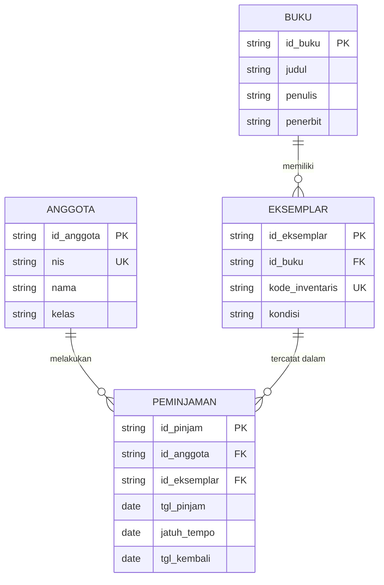
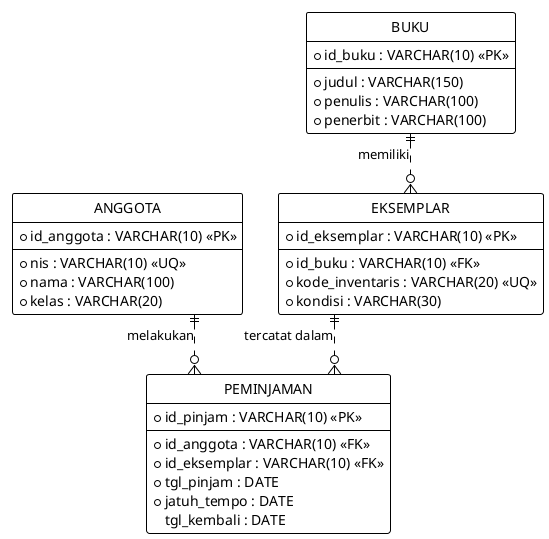
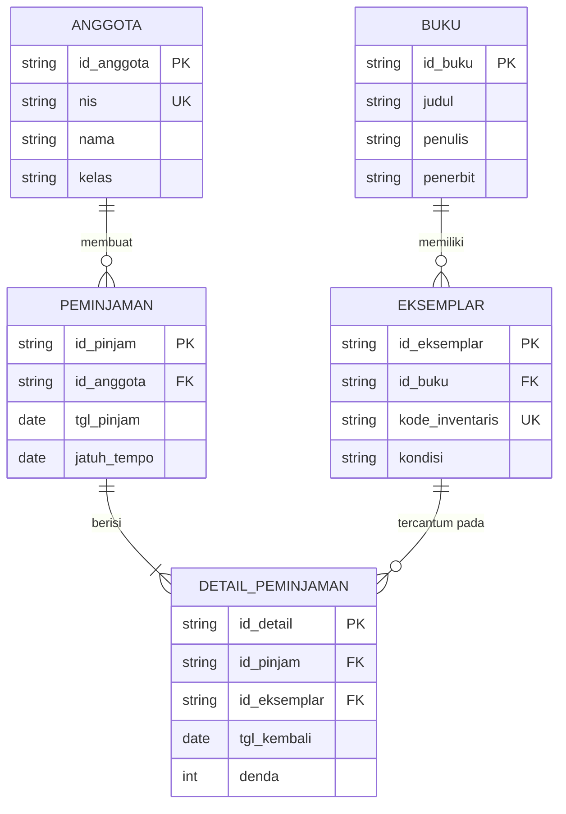
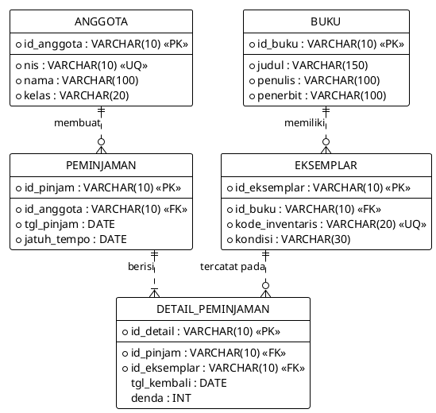

# Tugas Basis Data: ERD Perpustakaan Sekolah

Dokumen ini berisi analisis dan penyelesaian lengkap tugas perancangan basis data perpustakaan sekolah berdasarkan modul pembelajaran Teacherjourney.

---

## 1. Perancangan ERD Perpustakaan Sekolah

### A. Diagram Crow's Foot (Model Dasar 4 Entitas)

Berikut relasi antar entitas perpustakaan sekolah:

**Format Mermaid:**

**Format PlantUML:**

### B. Penjelasan Kardinalitas Dua Arah dan Batas Hubungan

1. **Relasi ANGGOTA ke PEMINJAMAN**
   * Sisi ANGGOTA (1..1): Setiap baris transaksi peminjaman wajib dimiliki oleh tepat satu siswa anggota perpustakaan. Tidak boleh ada pinjaman tanpa pemilik kartu.
   * Sisi PEMINJAMAN (0..N): Seorang anggota baru terdaftar belum tentu langsung meminjam buku (minimum 0). Seiring waktu, siswa tersebut dapat meminjam buku berkali-kali (maksimum N).

2. **Relasi BUKU ke EKSEMPLAR**
   * Sisi BUKU (1..1): Setiap fisik buku (eksemplar) wajib merujuk ke tepat satu data judul pada katalog buku.
   * Sisi EKSEMPLAR (0..N): Sebuah judul buku baru bisa saja diinput ke katalog sistem sebelum barang fisiknya tiba di rak (minimum 0). Satu judul yang populer dapat dibeli sebanyak puluhan eksemplar fisik (maksimum N).

3. **Relasi EKSEMPLAR ke PEMINJAMAN**
   * Sisi EKSEMPLAR (1..1): Setiap catatan transaksi peminjaman merujuk ke tepat satu fisik buku tertentu melalui kode inventarisnya.
   * Sisi PEMINJAMAN (0..N): Dalam riwayat peminjaman, satu buku fisik dapat dipinjam berkali-kali oleh anggota yang berganti-ganti (maksimum N), atau belum pernah dipinjam sama sekali sejak dibeli (minimum 0).

*Catatan aturan validasi aplikasi*: Kardinalitas riwayat mencatat 0..N peminjaman untuk satu eksemplar, namun aturan operasional perpustakaan membatasi bahwa dalam satu waktu hanya boleh ada 1 peminjaman aktif per eksemplar (status pinjaman aktif ditandai dengan nilai `tgl_kembali IS NULL`).

---

## 2. Kamus Data

Tabel di bawah merinci spesifikasi struktur kolom untuk keempat entitas:

### Tabel ANGGOTA
Menyimpan data identitas siswa yang terdaftar sebagai anggota perpustakaan.

| Nama Kolom | Makna Data | Tipe Data Usulan | Wajib (NOT NULL) | Keterangan Kunci | Contoh Nilai |
| :--- | :--- | :--- | :--- | :--- | :--- |
| `id_anggota` | Nomor identitas unik anggota perpustakaan | VARCHAR(10) | Wajib | Primary Key | A01 |
| `nis` | Nomor Induk Siswa dari sekolah | VARCHAR(10) | Wajib | Unique Key | 102938 |
| `nama` | Nama lengkap siswa | VARCHAR(100) | Wajib | - | Rani Maharani |
| `kelas` | Rombongan belajar siswa saat ini | VARCHAR(20) | Wajib | - | X RPL 1 |

*Catatan*: NIS menggunakan tipe VARCHAR agar digit angka nol di depan tidak hilang saat disimpan.

### Tabel BUKU
Menyimpan katalog judul pustaka tanpa membedakan salinan fisik.

| Nama Kolom | Makna Data | Tipe Data Usulan | Wajib (NOT NULL) | Keterangan Kunci | Contoh Nilai |
| :--- | :--- | :--- | :--- | :--- | :--- |
| `id_buku` | Kode unik katalog buku | VARCHAR(10) | Wajib | Primary Key | B01 |
| `judul` | Judul buku | VARCHAR(150) | Wajib | - | Dasar Basis Data |
| `penulis` | Nama penulis buku | VARCHAR(100) | Wajib | - | Ahmad Fauzi |
| `penerbit` | Nama badan penerbit | VARCHAR(100) | Wajib | - | Informatika Press |

### Tabel EKSEMPLAR
Menyimpan data fisik buku yang beredar di rak perpustakaan.

| Nama Kolom | Makna Data | Tipe Data Usulan | Wajib (NOT NULL) | Keterangan Kunci | Contoh Nilai |
| :--- | :--- | :--- | :--- | :--- | :--- |
| `id_eksemplar` | Kode unik internal untuk setiap buku fisik | VARCHAR(10) | Wajib | Primary Key | E01 |
| `id_buku` | Relasi ke katalog judul buku | VARCHAR(10) | Wajib | Foreign Key (ke BUKU) | B01 |
| `kode_inventaris` | Barcode atau label fisik pada punggung buku | VARCHAR(20) | Wajib | Unique Key | INV-2026-001 |
| `kondisi` | Kondisi fisik buku (Baik, Rusak Ringan, Rusak Berat) | VARCHAR(30) | Wajib | - | Baik |

### Tabel PEMINJAMAN
Menyimpan transaksi sirkulasi peminjaman dan pengembalian.

| Nama Kolom | Makna Data | Tipe Data Usulan | Wajib (NOT NULL) | Keterangan Kunci | Contoh Nilai |
| :--- | :--- | :--- | :--- | :--- | :--- |
| `id_pinjam` | Nomor unik transaksi pinjam | VARCHAR(10) | Wajib | Primary Key | P01 |
| `id_anggota` | Siswa yang meminjam | VARCHAR(10) | Wajib | Foreign Key (ke ANGGOTA) | A01 |
| `id_eksemplar` | Salinan fisik buku yang dipinjam | VARCHAR(10) | Wajib | Foreign Key (ke EKSEMPLAR) | E01 |
| `tgl_pinjam` | Tanggal transaksi peminjaman dibuat | DATE | Wajib | - | 2026-10-12 |
| `jatuh_tempo` | Batas akhir pengembalian buku | DATE | Wajib | - | 2026-10-19 |
| `tgl_kembali` | Tanggal buku dikembalikan ke perpustakaan | DATE | Boleh Kosong (NULL) | - | 2026-10-15 |

*Catatan*: `tgl_kembali` bernilai NULL saat buku masih dipinjam.

---

## 3. Kasus Uji Validasi Desain Basis Data

Pengujian berikut dilakukan untuk memastikan integritas data berjalan sesuai aturan bisnis:

| No | Skenario Pengujian | Masukan Data Uji | Hasil yang Diharapkan | Penjelasan Aturan Basis Data |
| :--- | :--- | :--- | :--- | :--- |
| 1 | Siswa A02 mencoba meminjam eksemplar E01 saat transaksi P01 atas buku E01 masih berjalan (belum kembali). | Peminjaman baru untuk E01 dengan `tgl_kembali` pada transaksi sebelumnya masih bernilai NULL. | Ditolak oleh sistem. | Eksemplar sedang berada di tangan peminjam lain. Satu eksemplar hanya boleh memiliki 1 pinjaman aktif dalam satu waktu. |
| 2 | Buku E01 dikembalikan pada 15 Oktober 2026, lalu dipinjam kembali oleh siswa lain pada 16 Oktober 2026. | Transaksi P01 diupdate dengan `tgl_kembali = '2026-10-15'`, lalu dibuat transaksi P03 untuk E01 pada `2026-10-16`. | Diterima oleh sistem. | Transaksi lama sudah berstatus selesai, sehingga status eksemplar E01 kembali tersedia di rak. |
| 3 | Input transaksi peminjaman baru menggunakan ID anggota yang belum terdaftar di sistem. | `id_anggota = 'A99'` (tidak ada di tabel ANGGOTA). | Ditolak oleh sistem database. | Pelanggaran Foreign Key constraint (referential integrity). Transaksi wajib merujuk ke anggota yang sah. |
| 4 | Input data eksemplar baru dengan kode inventaris yang persis sama dengan kode yang sudah ada. | Eksemplar baru dengan `kode_inventaris = 'INV-2026-001'`. | Ditolak oleh sistem database. | Pelanggaran UNIQUE constraint pada kolom `kode_inventaris`. Barcode buku tidak boleh duplikat. |
| 5 | Input data peminjaman di mana tanggal kembali lebih awal daripada tanggal pinjam buku. | `tgl_pinjam = '2026-10-12'` dan `tgl_kembali = '2026-10-09'`. | Ditolak oleh sistem database. | Pelanggaran aturan validasi CHECK constraint tanggal (`tgl_kembali >= tgl_pinjam`). Tanggal tidak logis. |

---

## 4. Analisis Pemisahan Entitas BUKU dan EKSEMPLAR

### Masalah jika BUKU dan EKSEMPLAR Digabung
Jika entitas BUKU dan EKSEMPLAR disatukan menjadi satu tabel tunggal (misalnya tabel `BUKU_FISIK`), akan timbul redundansi data dan risiko inkonsistensi yang parah:

1. **Pemborosan ruang simpan (Redundansi)**: Data judul, penulis, dan penerbit harus diketik ulang sebanyak salinan buku yang dimiliki perpustakaan. Jika perpustakaan memiliki 20 buku dengan judul yang sama, teks judul dan nama pengarang akan tersimpan 20 kali.
2. **Anomali pembaruan (Update Anomaly)**: Apabila terjadi koreksi ejaan nama penulis, petugas perpustakaan harus mengedit 20 baris data satu per satu. Jika ada satu baris terlewat, data katalog menjadi rancu.

### Dampak Nyata pada Kasus Tiga Salinan Buku (Satu Rusak)
Bayangkan sekolah memiliki 3 buku "Dasar Basis Data". Dua dalam kondisi baik, satu rusak:

* **Pada rancangan yang digabung**: Data kondisi rusak harus dicatat di baris buku itu sendiri. Petugas kesulitan mengetahui apakah sekolah masih memiliki buku "Dasar Basis Data" yang layak pinjam, karena atribut status bercampur dengan atribut bibliografi judul. Saat melakukan pencarian katalog, judul yang sama muncul tiga kali di layar pencarian siswa.
* **Pada rancangan yang dipisah (BUKU dan EKSEMPLAR)**: Data judul hanya ada satu baris di tabel `BUKU` (`B01: Dasar Basis Data`). Tabel `EKSEMPLAR` memiliki 3 baris:
  * `E01`: merujuk `B01`, kondisi Baik.
  * `E02`: merujuk `B01`, kondisi Baik.
  * `E03`: merujuk `B01`, kondisi Rusak.
  Sistem dapat langsung menampilkan informasi: "Judul: Dasar Basis Data, Total Salinan: 3, Tersedia untuk Dipinjam: 2, Rusak: 1". Pengelolaan sirkulasi menjadi rapi dan akurat.

---

## 5. Evaluasi Penggunaan Nama Siswa Sebagai Primary Key

### Apakah Nama Boleh Menjadi Primary Key?
Jawaban tegas: **Tidak boleh.**

### Alasan Teknis
Syarat fundamental sebuah Primary Key pada perancangan basis data adalah bernilai unik, tidak boleh bernilai kosong (NOT NULL), dan nilainya bersifat stabil (tidak mudah berubah). Nama orang melanggar seluruh prinsip tersebut karena memiliki probabilitas tinggi untuk kembar dan rentan mengalami perubahan penulisan gelar atau ejaan.

### Contoh Kasus Nyata
Di sebuah SMK, ada dua orang siswa yang memiliki nama persis sama:
* Siswa 1: Nama = "Muhammad Rizki", Kelas = X RPL 1, NIS = 102101.
* Siswa 2: Nama = "Muhammad Rizki", Kelas = XI TKJ 2, NIS = 101055.

Jika kolom `nama` dipaksakan menjadi Primary Key:
1. Saat petugas mendaftarkan Siswa 1, sistem berhasil menyimpan data.
2. Saat petugas mencoba mendaftarkan Siswa 2, sistem database akan menolak penyimpanan dengan pesan kesalahan duplikasi kunci utama (*duplicate key violation*). Siswa kedua tidak akan pernah bisa memiliki akun perpustakaan.
3. Lebih buruk lagi pada tabel peminjaman: jika ada catatan bahwa "Muhammad Rizki" meminjam buku dan belum mengembalikan, petugas tidak bisa membuktikan siswa mana yang sebenarnya membawa buku tersebut.

Oleh karena itu, sistem wajib menggunakan pengenal unik buatan seperti `id_anggota` atau memanfaatkan nomor induk resmi sekolah (`nis`).

---

## 6. Pengembangan Model: Header Transaksi dan Detail Peminjaman

### Latar Belakang Perubahan Model
Pada rancangan awal, setiap satu baris di tabel PEMINJAMAN hanya merekam 1 anggota dan 1 eksemplar. Jika seorang siswa meminjam 3 buku sekaligus dalam satu kunjungan, sistem terpaksa membuat 3 baris peminjaman terpisah dengan 3 ID transaksi berbeda. Tidak ada nomor nota atau struk bersama yang menyatukan peristiwa kunjungan tersebut.

Untuk mendukung pencatatan satu nota/struk dengan banyak buku, model dikembangkan menjadi pola Master-Detail dengan memecah transaksi menjadi entitas `PEMINJAMAN` (header nota) dan `DETAIL_PEMINJAMAN` (rincian buku per nota).

### Diagram ERD Master-Detail

**Format Mermaid:**

**Format PlantUML:**

### Penjelasan Perubahan Struktur dan Atribut

1. **Atribut yang Tetap di PEMINJAMAN (Header Transaksi)**
   * `id_pinjam` (PK): Menjadi nomor struk atau nomor transaksi peminjaman.
   * `id_anggota` (FK): Menandai siswa yang melakukan peminjaman pada nota tersebut.
   * `tgl_pinjam`: Tanggal transaksi dibuat di meja sirkulasi.
   * `jatuh_tempo`: Batas waktu pengembalian default untuk nota tersebut.

2. **Atribut yang Berpindah ke DETAIL_PEMINJAMAN**
   * `id_eksemplar` (FK): Berpindah ke detail karena dalam satu nota bisa terdapat beberapa eksemplar buku yang berbeda.
   * `tgl_kembali`: Wajib berpindah ke detail. Alasannya, siswa bisa saja mengembalikan buku pertama pada hari ketiga, sedangkan buku kedua baru dikembalikan tepat di hari ketujuh. Status pengembalian melekat pada masing-masing fisik buku, bukan pada keseluruhan nota.
   * `denda` (Atribut tambahan): Dapat ditambahkan pada tabel detail untuk mencatat keterlambatan per buku jika ada.

3. **Kunci pada Tabel DETAIL_PEMINJAMAN**
   * Pilihan 1 (Surrogate Key): Menggunakan kolom khusus `id_detail` sebagai Primary Key.
   * Pilihan 2 (Composite Key): Menggunakan pasangan gabungan (`id_pinjam`, `id_eksemplar`) sebagai Primary Key, sehingga satu buku fisik tidak bisa diinput dua kali di dalam satu nota yang sama.

4. **Relasi Baru yang Terbentuk**
   * **ANGGOTA ke PEMINJAMAN (1:N)**: Satu anggota dapat memiliki 0 hingga banyak nota peminjaman. Setiap nota wajib milik tepat satu anggota.
   * **PEMINJAMAN ke DETAIL_PEMINJAMAN (1:N)**: Satu nota peminjaman berisi minimal 1 hingga banyak baris rincian buku. Setiap baris rincian wajib terikat pada tepat 1 nota peminjaman.
   * **EKSEMPLAR ke DETAIL_PEMINJAMAN (1:N)**: Satu fisik buku dapat tercatat di beberapa baris detail peminjaman sepanjang riwayatnya. Setiap baris rincian mencatat tepat 1 eksemplar buku.
   * *Aturan pinjaman aktif*: Tetap diberlakukan melalui validasi bahwa tidak boleh ada dua baris di tabel `DETAIL_PEMINJAMAN` untuk `id_eksemplar` yang sama dengan kondisi `tgl_kembali IS NULL`.
